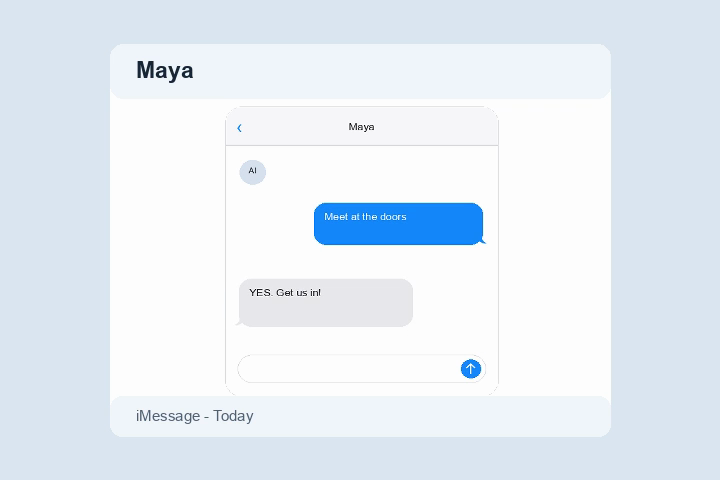
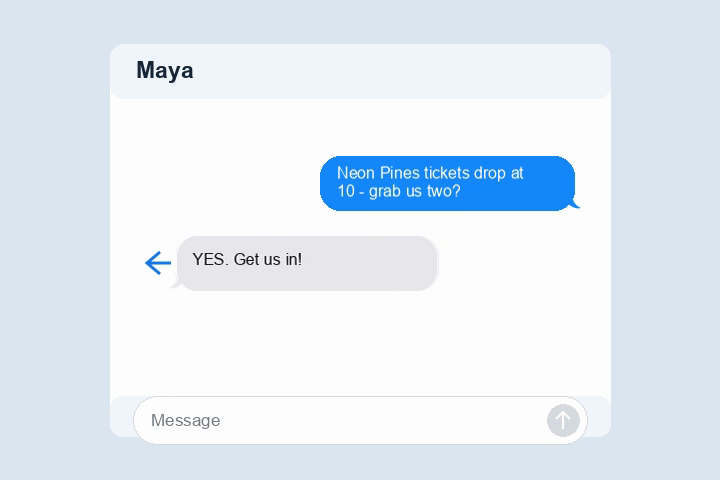
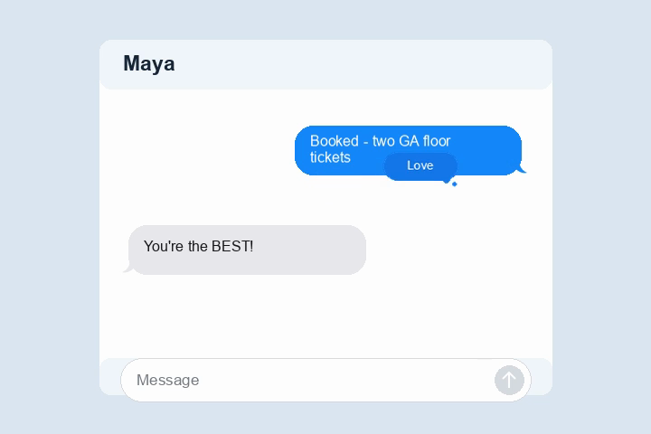
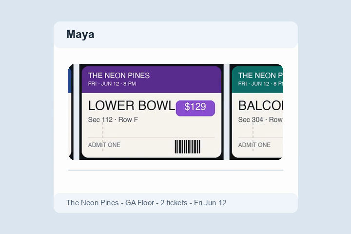

# Shot pitch

Two friends, Alex and Maya, lock in concert tickets over iMessage: Alex proposes grabbing Neon Pines tickets, the seating options get browsed under one pinned heading, the booking is celebrated in the thread, and the finished ticket is in hand.

**Director** · 30 fps · confirmation optional

## ask · frames 0–71

Open the story: Alex proposes grabbing tickets and Maya says yes, establishing both friends and the goal.

Alex's draft types into the composer, flies into the transcript as a blue bubble, and Maya's gray reply arrives after a quiet beat. Header and composer stay fixed.

> Meet at the doors

Send an outgoing text and receive a reply Draft characters arrive in the composer, transfer into an outgoing blue bubble, and an incoming gray reply arrives after a pause. The phone, conversation header, composer field and reading area stay in place.

Content settings

```json
{
  "heading": "Maya",
  "reply": "YES. Get us in!",
  "detail": "iMessage - Today"
}
```



[Preview](final-v2/ask/preview.mp4)

[Code](final-v2/ask/scene.json)

[Motion example](../../../imessagevideo-dl/skill/imessage-video/assets/seed/previews/conversation-handoff.mp4)

[Implementation](../../../imessagevideo-dl/skill/imessage-video/assets/seed/runtime/motion/packs/handoff.mjs)

## browse · frames 72–143

Show exactly which message is being answered before the reply sends.

Maya's 'YES. Get us in!' bubble follows the swipe; an arrow appears behind it, the row springs back, and a quote draft opens above the composer naming the answered message.

> YES. Get us in!

Swipe one message to quote it Only the chosen bubble follows the drag. An arrow appears behind it, then the row returns and its quote opens above the composer. Other transcript rows, header and reply input position.

Content settings

```json
{
  "heading": "Maya",
  "reply": "Neon Pines tickets drop at 10 - grab us two?",
  "title": "Replying to Maya"
}
```



[Preview](proof-quote/preview.mp4)

[Code](proof-quote/scene.json)

[Motion example](../../../imessagevideo-dl/skill/imessage-video/assets/seed/previews/swipe-to-quote.mp4)

[Implementation](../../../imessagevideo-dl/skill/imessage-video/assets/seed/runtime/motion/packs/conversation.mjs)

## celebrate · frames 144–215

Pay off the booking emotionally: Alex's 'booked' news earns Maya's excited reply and it gets hearted.

Alex's outgoing 'booked' bubble sits above Maya's incoming reply; the Love reaction arcs in and lands on Maya's bubble as a badge while the rest of the transcript stays put.

> You're the BEST!

Attach a chosen reaction to its message The selected reaction follows a curved approach, shrinks into a corner badge and settles as the nearby text row makes room. Message copy, heading and composer. Earlier messages stay put.

Content settings

```json
{
  "heading": "Maya",
  "reply": "Booked - two GA floor tickets",
  "action": "Love"
}
```



[Preview](proof-celebrate/preview.mp4)

[Code](proof-celebrate/scene.json)

[Motion example](../../../imessagevideo-dl/skill/imessage-video/assets/seed/previews/reaction-attach.mp4)

[Implementation](../../../imessagevideo-dl/skill/imessage-video/assets/seed/runtime/motion/packs/conversation.mjs)

## ticket · frames 216–287

Close on the secured tickets themselves: the seating cards swipe through under Maya's pinned header so the booked options stay in view.

Under the fixed 'Maya' heading and ticket detail line, the clipped rail of ticket cards glides left until the next card settles - the swipe donated from the second clip.

> The Neon Pines - GA Floor - 2 tickets - Fri Jun 12

Slide the photos beneath a fixed heading Adjacent photos translate together on one horizontally clipped rail. The heading, viewport, divider and supporting footer stay in place.

Content settings

```json
{
  "heading": "Maya",
  "direction": "left",
  "photos": [
    "assets/ticket-ga-floor.png",
    "assets/ticket-lower-bowl.png",
    "assets/ticket-balcony.png",
    "assets/ticket-vip-pit.png"
  ]
}
```



[Preview](final-v2/ticket/preview.mp4)

[Code](final-v2/ticket/scene.json)

[Photo 1](assets/ticket-ga-floor.png)

[Photo 2](assets/ticket-lower-bowl.png)

[Photo 3](assets/ticket-balcony.png)

[Photo 4](assets/ticket-vip-pit.png)

[Motion example](../../../imessagevideo-dl/skill/imessage-video/assets/seed/previews/photos-under-fixed-heading.mp4)

[Implementation](../../../imessagevideo-dl/skill/imessage-video/assets/seed/runtime/motion/packs/core.mjs)


Plan revision `e30eeb2e65a4fd633f96a70344de9479a7fa04f9ef8c8ca5d20d2ef8880ae82e`
