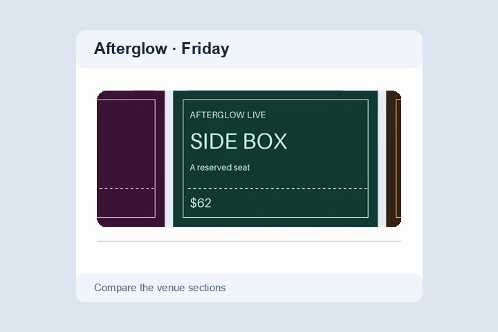
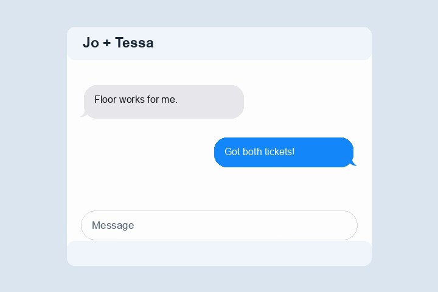

# Shot pitch

Jo and Tessa get Afterglow tickets. Show how they decide where to sit and confirm both tickets.

**Director** · 30 fps · awaiting confirmation

## open · frames 0–107

Establish a concrete invitation.

Jo sends a draft into the conversation.

> Tickets for Afterglow?

Send from the composer into history The draft box collapses toward its right edge while the outgoing balloon rises, slightly overshoots, then settles into its transcript slot. The conversation heading, prior reply, and composer field stay fixed. The send control disappears at the trigger.

Content settings

```json
{
  "heading": "Jo + Tessa",
  "reply": "Presale just opened."
}
```


[Preview](proof-open/preview.mp4)

[Code](proof-open/scene.json)

[Motion example](../imessagevideo/skill/imessage-video/assets/seed/previews/draft-send-flight.mp4)

[Implementation](../imessagevideo/skill/imessage-video/assets/seed/runtime/motion/packs/conversation.mjs)

## choice · frames 108–203

Give the two friends a choice.

Browse the available tickets beneath the fixed event heading.

> Afterglow · Friday

Slide the photos beneath a fixed heading Adjacent photos translate together on one horizontally clipped rail. The heading, viewport, divider and supporting footer stay in place.

Content settings

```json
{
  "heading": "Jo + Tessa",
  "detail": "Compare the venue sections",
  "photos": [
    "art/ticket-1.png",
    "art/ticket-2.png",
    "art/ticket-3.png",
    "art/ticket-4.png"
  ]
}
```



[Preview](proof-browse/preview.mp4)

[Code](proof-browse/scene.json)

[Photo 1](art/ticket-1.png)

[Photo 2](art/ticket-2.png)

[Photo 3](art/ticket-3.png)

[Photo 4](art/ticket-4.png)

[Motion example](../imessagevideo/skill/imessage-video/assets/seed/previews/photos-under-fixed-heading.mp4)

[Implementation](../imessagevideo/skill/imessage-video/assets/seed/runtime/motion/packs/core.mjs)

## payoff · frames 204–311

Confirm that both friends have a ticket.

The confirmation leaves the composer and settles below the plan.

> Got both tickets!

Send from the composer into history The draft box collapses toward its right edge while the outgoing balloon rises, slightly overshoots, then settles into its transcript slot. The conversation heading, prior reply, and composer field stay fixed. The send control disappears at the trigger.

Content settings

```json
{
  "heading": "Jo + Tessa",
  "reply": "Floor works for me."
}
```



[Preview](proof-payoff/preview.mp4)

[Code](proof-payoff/scene.json)

[Motion example](../imessagevideo/skill/imessage-video/assets/seed/previews/draft-send-flight.mp4)

[Implementation](../imessagevideo/skill/imessage-video/assets/seed/runtime/motion/packs/conversation.mjs)


Plan revision `5effbeb9a5e10b338abcbfa31de4b35b589712e9817ed7fdc2cb8a21070956ba`
