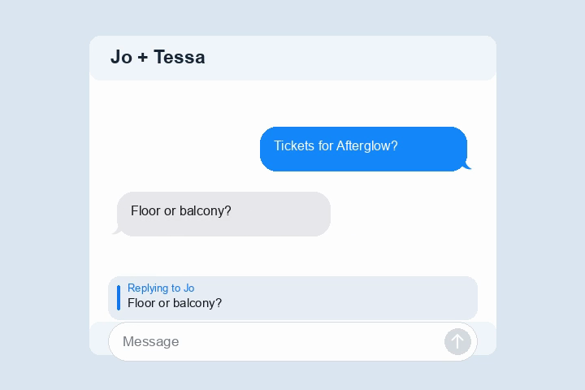
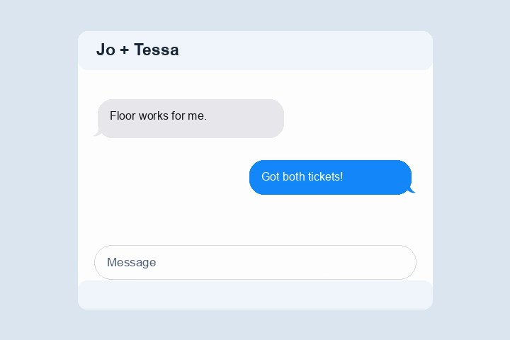

# Shot pitch

Jo and Tessa get Afterglow tickets. Show how they decide where to sit and confirm both tickets.

**Director** · 30 fps · awaiting confirmation

## open · frames 0–107

Establish a concrete invitation.

Jo sends a draft into the conversation.

> Tickets for Afterglow?

Send from the composer into history The draft box collapses toward its right edge while the outgoing balloon rises, slightly overshoots, then settles into its transcript slot. The conversation heading, prior reply, and composer field stay fixed. The send control disappears at the trigger.

Content settings

```json
{
  "heading": "Jo + Tessa",
  "reply": "Presale just opened."
}
```


[Preview](proof-open/preview.mp4)

[Code](proof-open/scene.json)

[Motion example](../../imessagevideo/skill/imessage-video/assets/seed/previews/draft-send-flight.mp4)

[Implementation](../../imessagevideo/skill/imessage-video/assets/seed/runtime/motion/packs/conversation.mjs)

## choice · frames 108–203

Make it clear exactly which earlier message the answer refers to.

Tessa drags only the seating question. It returns to its slot while the quoted copy opens above the composer.

> Floor or balcony?

Swipe one message to quote it Only the chosen bubble follows the drag. An arrow appears behind it, then the row returns and its quote opens above the composer. Other transcript rows, header and reply input position.

Content settings

```json
{
  "heading": "Jo + Tessa",
  "reply": "Tickets for Afterglow?",
  "title": "Replying to Jo"
}
```



[Preview](proof-reply/preview.mp4)

[Code](proof-reply/scene.json)

[Motion example](../../imessagevideo/skill/imessage-video/assets/seed/previews/swipe-to-quote.mp4)

[Implementation](../../imessagevideo/skill/imessage-video/assets/seed/runtime/motion/packs/conversation.mjs)

## payoff · frames 204–311

Confirm that both friends have a ticket.

The confirmation leaves the composer and settles below the plan.

> Got both tickets!

Send from the composer into history The draft box collapses toward its right edge while the outgoing balloon rises, slightly overshoots, then settles into its transcript slot. The conversation heading, prior reply, and composer field stay fixed. The send control disappears at the trigger.

Content settings

```json
{
  "heading": "Jo + Tessa",
  "reply": "Floor works for me."
}
```



[Preview](proof-payoff/preview.mp4)

[Code](proof-payoff/scene.json)

[Motion example](../../imessagevideo/skill/imessage-video/assets/seed/previews/draft-send-flight.mp4)

[Implementation](../../imessagevideo/skill/imessage-video/assets/seed/runtime/motion/packs/conversation.mjs)


Plan revision `6c011e9afa31beeb095f4e826fcb5050903c4f2a9bff44ef33083c79f5b0f1d0`
